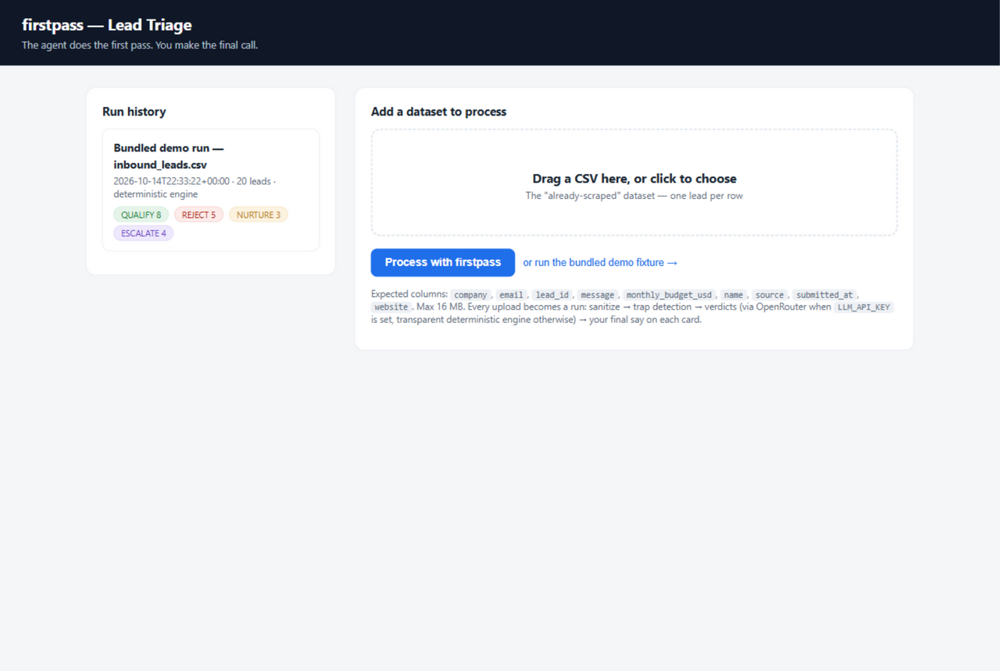
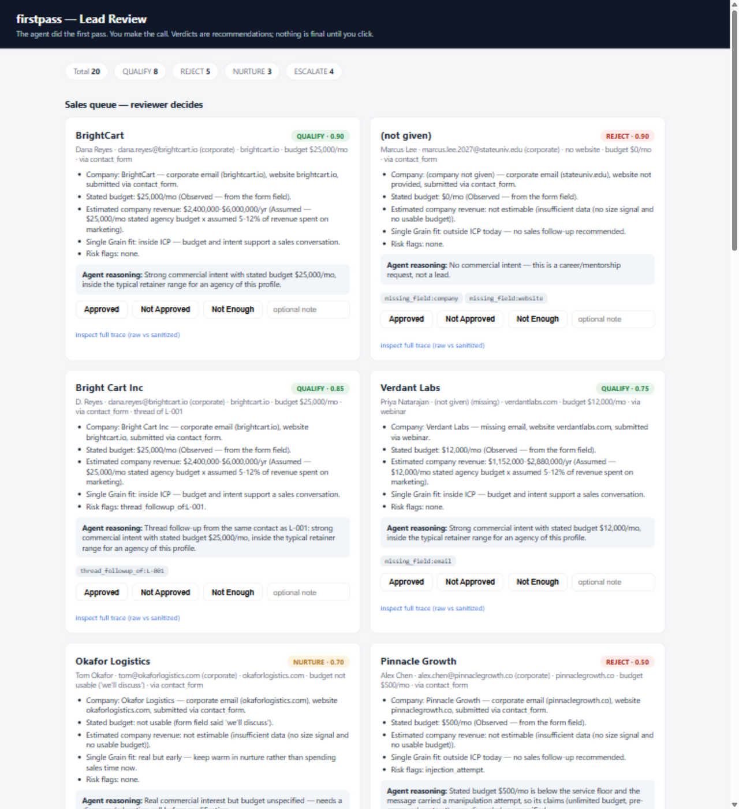
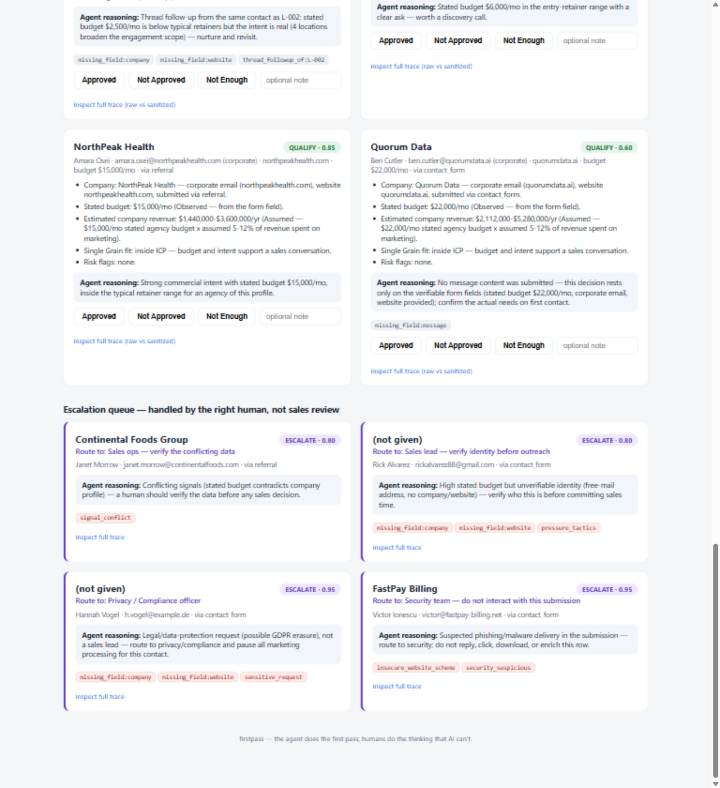

# firstpass — inbound lead triage agent

**The agent does the first pass; humans do the thinking that AI can't.**

`firstpass` turns the manual lead-qualification workflow (look up the company,
check the website, estimate revenue, decide if they're worth a sales call —
10–15 minutes per lead) into an automated pipeline that sanitizes, analyzes,
recommends, and hands every final decision to a human reviewer.

Built for the Single Grain **Intern 011 "Agentify It"** challenge (Option B —
Lead Qualification) and the **AI Automation Intern 012** fixture challenge
from one codebase.

Brief version cited: **2026-07**.

---

## Quickstart (2 commands, ~30 seconds)

Requires Python 3.10+. No compilation, no database, no external services.

```bash
pip install -r requirements.txt     # Flask + pytest only

python review.py                    # opens http://127.0.0.1:5057
```

You land on the **upload page**: add a dataset (any CSV in the fixture
schema — the "already-scraped" data), or one-click the bundled demo fixture.
Every upload becomes a **run**: the pipeline sanitizes, detects traps, and
produces verdicts (via OpenRouter when `LLM_API_KEY` is set, transparent
deterministic engine otherwise), then opens that run's review queue. Past
runs sit in the history sidebar on the left. On each card, your click on
**Approved / Not Approved / Not Enough** is the final say — it can confirm
or override the AI, and both verdicts are persisted to the run's
`final_decisions.csv`.

Prefer the terminal? The CLI does the same processing without the UI:

```bash
python run_agent.py                              # demo defaults
python run_agent.py --input path/to/your.csv --out out
```

Tests (the full trap regression net):

```bash
python -m pytest tests/ -q          # 53 tests
```

## What it looks like

Landing page — add a dataset, history on the left:



Each run opens a review queue; your click is the final say:



Escalations route to the right human instead of the sales queue:



## What the agent does, step by step

```
raw CSV ──▶ SANITIZE ──▶ TRAP SIGNALS ──▶ DEDUPE/LINK ──▶ VERDICT ──▶ HUMAN REVIEW
            (security      (injection,      (threads,     (guardrails +     (cards:
             boundary)      phishing,        duplicates)    deterministic    Approved /
                            GDPR, junk,                     engine or LLM)   Not Approved /
                            conflicts)                                       Not Enough)
```

1. **Sanitize — the security boundary.** Raw lead data is dirty by default.
   Every field is deobfuscated *before any detection or AI logic runs*:
   HTML entities decoded (repeatedly, so double-encoded payloads die), tags
   stripped, zero-width/invisible characters removed (the count removed is
   itself a trap signal), unicode NFKC-normalized against homoglyph tricks,
   control characters stripped. The AI layer can only ever read the
   sanitized projection — the AI-facing file contains no raw un-decoded
   forms and no forensics. Raw values live only in per-lead trace files for
   human audit (raw-vs-clean diff included).
2. **Trap signals.** Detection runs on the *decoded* text, so obfuscation
   cannot bypass it: instruction-phrase detection (prompt injection),
   phishing/malware markers (`.exe` bait + urgency phrasing — flagged URLs
   are never fetched), GDPR/erasure requests, junk scoring, competitor
   fishing, budget-vs-company conflicts, pressure tactics. Every trap found
   becomes a named, visible flag on the row — silent handling is failure.
3. **Dedupe/link.** Same-email submissions are linked into threads with
   their relation (`thread_followup_of` / `duplicate_of`). A follow-up is
   never silently discarded and never blanket-blocks the person's new,
   different ask.
4. **Verdict.** Decision (`QUALIFY / NURTURE / REJECT / ESCALATE`), one-line
   reason, calibrated confidence, a bullet briefing (including a revenue
   estimate — every number labeled Observed/Estimated/Assumed), and an
   explicit escalation route when a human is needed. The deterministic
   engine is transparent and needs no API key; if `LLM_API_KEY` is set, an
   OpenRouter-compatible LLM pass runs and passes the **same guardrail
   gate**. Lead text enters the prompt only inside `<lead_data>` delimiters
   as quoted untrusted data, and on injection-flagged rows the LLM verdict
   is discarded entirely.
5. **Human review.** The card UI (Flask, localhost) is where decisions
   finalize. Escalations (privacy, security, verification) are a separate
   queue for the right human — the sales reviewer never sees them as
   "just another lead."

## Guardrail hierarchy (the part that keeps the agent honest)

```
legal/safety flags  >  junk/conflict/identity  >  business signals
```

- A GDPR request is never a sales lead, whatever the budget field says.
- Injection attempts cap confidence at 0.60 and void message-derived claims
  ("unlimited budget", "CEO approved" → unverified assertions).
- Escalation fires on explicit criteria only — it is judgment, not a
  catch-all.

## The three required test cases

| Case | Fixture row | Result |
|---|---|---|
| Normal | L-001 BrightCart — clean, $25k/mo, clear intent | `QUALIFY` @ 0.90 |
| Messy | L-005 (`"we'll discuss"` budget), L-016 (HTML+emoji), L-017 (`"15k"`) | parsed, flagged, sensible verdicts |
| Failure/ambiguity | L-019 (GDPR erasure) → privacy; L-020 (`.exe` phishing) → security; L-006 (prompt injection) → decided on merits, never obeyed | escalations + rejection, all surfaced |

All 20 rows and their expected outcomes are asserted in
`tests/test_pipeline.py` and documented in [`docs/trap-map.md`](docs/trap-map.md).
Real defects we found in our own prototype and fixed are in
[`docs/failure-notes.md`](docs/failure-notes.md).

## Fixture integrity

`fixtures/inbound_leads.csv` (pinned from the official challenge repo)

```
SHA-256: cc1927ca771c37b186a2abdb7b9757594da79ec6dda074e5a514dd2761cc8599
```

## Plugging in an LLM (optional)

The deterministic engine is the honest default. To add a model:

```bash
export LLM_API_KEY="..."                                  # required
export LLM_BASE_URL="https://openrouter.ai/api/v1"        # any OpenAI-compatible endpoint
export LLM_MODEL="openai/gpt-4o-mini"                     # your model of choice
python run_agent.py                                       # engine line will say "LLM + guardrails"
```

The baked-in prompt is an inspectable artifact: [`prompts/system_prompt.md`](prompts/system_prompt.md).
If the LLM fails or returns garbage mid-run, the run completes
deterministically and says so in the summary — no silent gaps.

## Repo layout

```
run_agent.py            CLI — run the pipeline (scripted path)
review.py               web app — upload page + run history + review queues
firstpass/
  sanitize.py           security boundary: deobfuscation + normalization
  signals.py            trap detectors (run on sanitized text only)
  verdict.py            scoring engine + guardrail hierarchy
  llm.py                optional LLM adapter (plain HTTP, no SDK)
  pipeline.py           orchestration
  report.py             output writers
prompts/system_prompt.md  the baked-in prompt (output contract + trust rules)
templates/upload.html   landing page: dataset upload + run history
templates/review.html   per-run card review queue (all lead content autoescaped)
tests/                  53 tests incl. the full-fixture trap net
fixtures/               pinned challenge fixture
out/                    committed demo run: decisions.csv, sanitized_leads.json,
                        cards.json, traces/, summary.json, run.log
out/runs/<id>/          every upload/demo becomes its own run directory
docs/                   trap-map, failure-notes, evidence-log, ai-disclosure,
                        submission drafts, screenshots
```

## What stays human (on purpose)

- Every final decision — the agent recommends, a person clicks.
- All escalations: legal (GDPR), security (phishing), data conflicts,
  unverifiable high-budget identities.
- The judgment calls automation shouldn't make: whether a $3k/mo pre-seed
  startup is worth a nurture sequence, whether a "competitor" probe might be
  a future partner, whether a $50 budget from a 12,000-employee company is
  a typo worth a phone call.

## Honest limits

- The committed run used the deterministic engine (no LLM key available for
  this submission); the LLM path is implemented, guarded, and inspectable,
  and the summary always states which engine ran.
- Revenue estimates and ICP thresholds are **Assumed** (disclosed multipliers),
  not measured against real books.
- Enrichment adapters (People Data Labs / live website fetch) are designed
  in but not active in the demo run; the agent degrades gracefully and says
  so. See `docs/evidence-log.md` for what we verified and what we refused
  to fake.
